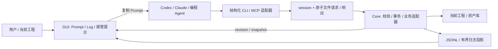

# 技术框架与本地协议

## 职责



Core 持有工程状态、权限、范围、数据校验与业务写入。CLI 只解析参数、验证 live session、提交请求和输出 JSON；GUI 不依赖 Agent 的自然语言总结推断成功。Prompt 是任务合同，不是权限校验器。业务适配器应暴露 inspect、validate、apply、undo、verify_complete；同一领域校验供 GUI / CLI 共用。

真实 GUI 主线程负责短状态变化；CPU / IO 重活走 worker，完成后回主线程提交与发出 revision。心跳和取消信号不能等待耗时推理 / 渲染锁；每批检查取消与范围。示例没有长任务，其 core lock 只覆盖小批内存操作，不能直接用于耗时生产任务。

## C-AL 示例状态机

| 状态 | 允许行为 | GUI |
| --- | --- | --- |
| waiting | identify、inspect | 可复制 Prompt，等外部 Agent |
| active | inspect、log、dry-run / apply、undo、finish、cancel | 身份提示、工作边框，业务结果实时刷新 |
| finished | inspect；由 GUI 新建会话 | 停止工作动效，保留结果与完成提示 |
| cancelled | inspect；由 GUI 新建会话 | 停止后续提交，已提交内容保留 |
| disconnected | 由 GUI 检测连接失败得到的呈现状态 | 显示断开，停动画，不假装任务完成 |

单次操作 completed 与整个任务 finished 区别明确。cancel 不自动 undo；finish 必须检查业务结果，而非只看 Agent summary。切换项目或新会话轮换身份，旧 Prompt、旧请求、旧响应不得跨会话生效。

## 文件桥接

示例 `.runtime/demo/` 下有 `session.json`、`requests/<session>-<request>.json`、`responses/<session>-<request>.json`、`activity.jsonl` 与有限归档。Host 唯一写业务和日志；CLI 写 requests；响应通过同目录临时文件与 `os.replace` 原子发布。临时文件不能被当作请求。

请求示意（token 仅由 CLI 读取本地文件，不放入 Prompt / Log）：

```json
{
  "id": "UUID",
  "sessionId": "Prompt 中的 UUID",
  "token": "从 session.json 读取",
  "command": "apply",
  "payload": {
    "expectedRevision": 0,
    "events": [{"name": "克制微笑", "start": 1.0, "end": 2.0, "track": 0}],
    "dryRun": false
  }
}
```

响应为 `{ok,result,error}`。示例约 1 秒 heartbeat、6 秒 TTL，单请求和响应 64 KiB，CLI 默认超时 10 秒，host 每轮处理最多 8 请求。命令与字段白名单拒绝任意执行，request ID 必须与文件名匹配。CLI 显式要求 `--session`，并在等待期间检查 heartbeat 和会话轮换。

业务 revision 独立于日志 seq：log 不让业务版本变化；dry-run 不创建结果 / run；apply / undo 后 projectRevision 增加。apply 需要 expectedRevision 防止基于旧 inspect 覆盖用户变化。apply 仅追加非重叠片段；undo 根据 run 的完整原始记录比较当前内容，有冲突拒绝整个撤回。

## 超时、幂等与恢复

请求被提交后 CLI 超时意味着结果未知。先 inspect，查看实际结果 / runId；禁止盲重试 apply。示例在同一 host 进程、同一会话保留最近 256 个 request ID 的响应缓存：相同 ID 与相同请求返回缓存，相同 ID 不同内容拒绝。缓存淘汰、host 重启后不保证持久幂等；生产接入应把 operationId / 请求账本与事务一起持久化。

会话心跳证明软件仍在响应，不证明 Agent 仍在工作。生产软件应额外记录 lastAgentActivity；长时间无消息显示“Agent 暂无新消息”，不要伪造百分比。取消只能在提交边界阻断后续工作；已提交数据仍需业务撤回策略。

## 本地安全与生命周期

token 用于约束使用桥接的进程，并非同一账户恶意进程隔离。生产状态目录使用用户私有 ACL / 权限，避免公共临时目录；日志不得记录 token 或完整私密 Prompt。限制请求大小、枚举、数值范围和批次；检验参数不等于授予任意文件 / shell 权限。

示例 UI HTTP 只绑定 `127.0.0.1`，限制 Host，写请求要求同源 Origin 与随机 `X-AgentLink-UI` token，无 CORS；HTTP 仅提供 snapshot、取消 / 新会话 / 清归档等 UI 操作。生产桌面可改成 Qt signal、Tauri invoke，CLI 文件通道保持独立。

示例启动通过独占目录锁防止第二 host 使用相同状态目录。正常退出只移除自己持有的 session / lock；异常退出留下锁，先确认没有 host 再手工移除 owner.lock。进程恢复、持久工程事务、request tombstone / 幂等账本属于生产补齐内容。

