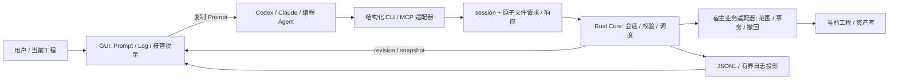

# 技术框架与本地协议

## 职责



Rust Core 持有通用控制状态、会话与协议校验，宿主业务适配器持有工程、范围、数据校验和写入。CLI 解析参数、绑定 project / session、提交请求与输出 JSON；GUI 依赖权威状态。Prompt 是任务合同，不是权限校验器。业务适配器暴露 inspect、dry-run / apply、undo、finish；同一领域校验供 GUI / CLI 共用。

真实 GUI 主线程负责短状态变化；CPU / IO 重活走 worker，完成后回主线程提交。Rust 示例的心跳独立线程运行，业务 adapter 请求串行且最多等待 5 秒，取消要等待当前请求返回。生产长任务必须改为任务 ID / 分批进度与提交边界取消，不能把此串行示例直接当即时取消实现。

## C-AL 示例状态机

| 状态 | 允许行为 | GUI |
| --- | --- | --- |
| waiting | identify、inspect | 可复制 Prompt，等外部 Agent |
| active | inspect、log、dry-run / apply、undo、finish、cancel | 身份提示、工作边框，业务结果实时刷新 |
| finished | inspect / events / cleanup；重启 host 创建新 session | 保留结果与完成提示 |
| cancelled | inspect / events / cleanup；重启 host 创建新 session | 停止后续提交，已提交内容保留 |
| disconnected | 由 GUI 检测连接失败得到的呈现状态 | 显示断开，停动画，不假装任务完成 |

单次操作 completed 与整个任务 finished 区别明确。cancel 不自动 undo；finish 必须检查业务结果，而非只看 Agent summary。切换项目或新会话轮换身份，旧 Prompt、旧请求、旧响应不得跨会话生效。

## 文件桥接

Rust v1 示例 `.runtime/rust-demo/` 下有 session.json、requests、responses、activity.jsonl 和有限归档。CLI / SDK 写请求；Rust 唯一收取请求和写日志，域内写入交给 adapter。文件通过同目录临时写入后 rename 发布，处理中的请求领取为 `.working`，不与普通过期清理混用。详细字段见 [协议 v1](08-protocol-v1.md)。

请求示意（token 仅由 CLI 读取本地文件，不放入 Prompt / Log）：

```json
{
  "version": 1,
  "id": "UUID",
  "sessionId": "Prompt 中的 UUID",
  "projectId": "demo",
  "token": "从 session.json 读取",
  "command": "apply",
  "payload": {
    "expectedRevision": 0,
    "events": [{"name": "克制微笑", "start": 1.0, "end": 2.0, "track": 0}],
    "dryRun": false
  }
}
```

响应为 `{version,id,ok,result,error}`，error 含稳定 code 与 message。约 1 秒 heartbeat、6 秒 TTL，包上限 64 KiB，CLI 默认超时 10 秒，每轮最多 8 请求。全部客户端命令都是 live-only，显式绑定 session / project；旧教学 CLI 的 --live 参数不属于 v1。

业务 revision 独立于日志 seq；由 adapter 在 inspect 的 domain 内返回。dry-run 不创建结果 / run；apply / undo 后 projectRevision 增加。时间线 adapter 的 apply 绑定 expectedRevision，仅追加非重叠片段；undo 比较本 session 的完整原始记录，有冲突拒绝整个撤回。

## 超时、幂等与恢复

请求被提交后 CLI 超时意味着结果未知。先 inspect，查看实际结果 / runId；禁止盲重试 apply。示例在同一 host 进程、同一会话保留最近 256 个 request ID 的响应缓存：相同 ID 与相同请求返回缓存，相同 ID 不同内容拒绝。缓存淘汰、host 重启后不保证持久幂等；生产接入应把 operationId / 请求账本与事务一起持久化。

会话心跳证明软件仍在响应，不证明 Agent 仍在工作。生产软件应额外记录 lastAgentActivity；长时间无消息显示“Agent 暂无新消息”，不要伪造百分比。取消只能在提交边界阻断后续工作；已提交数据仍需业务撤回策略。

## 本地安全与生命周期

token 用于约束使用桥接的进程，并非同一账户恶意进程隔离。生产状态目录使用用户私有 ACL / 权限，避免公共临时目录；日志不得记录 token 或完整私密 Prompt。限制请求大小、枚举、数值范围和批次；检验参数不等于授予任意文件 / shell 权限。

Rust 主实现不启动网络服务；可选 Qt 面板通过 SDK / 文件 IPC 操作。纯 Python Web 教学版本单独展示 localhost HTTP GUI、Host / Origin / UI token 校验；它不改变 v1 传输协议。生产软件可用 Qt signal、Tauri invoke 呈现状态。

示例启动通过独占目录锁防止第二 host 使用相同状态目录。正常退出只移除自己持有的 session / lock；异常退出留下锁，先确认没有 host 再手工移除 owner.lock。进程恢复、持久工程事务、request tombstone / 幂等账本属于生产补齐内容。

